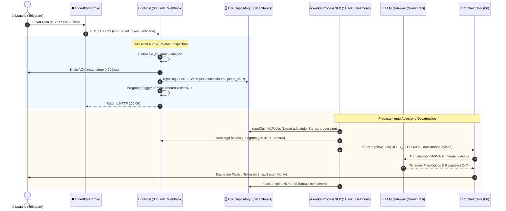
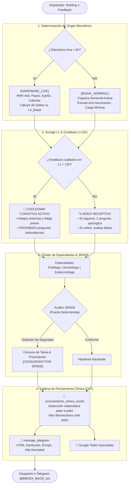
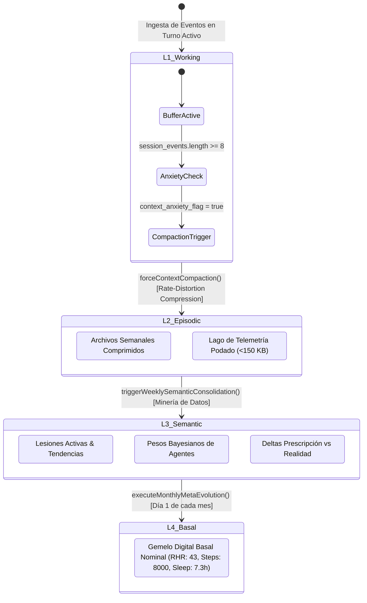
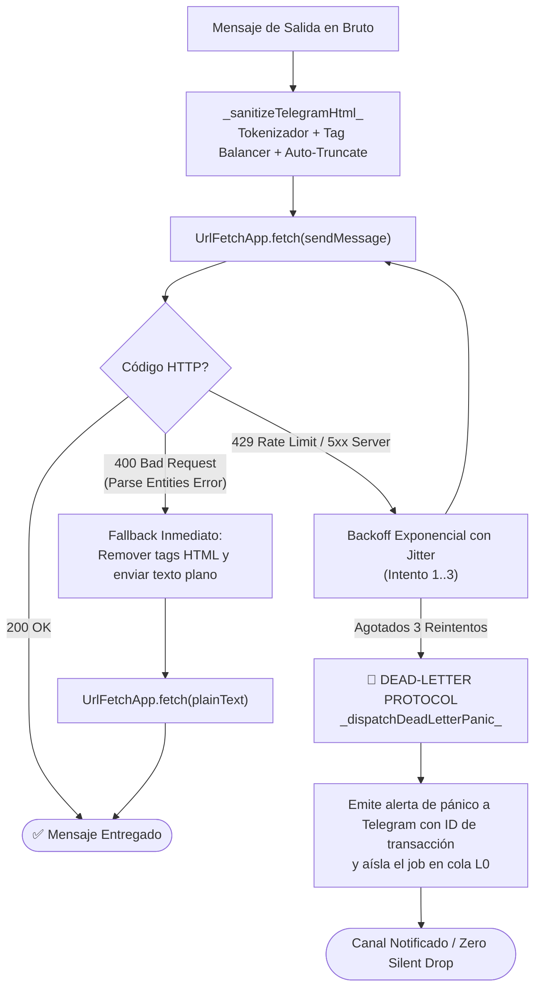
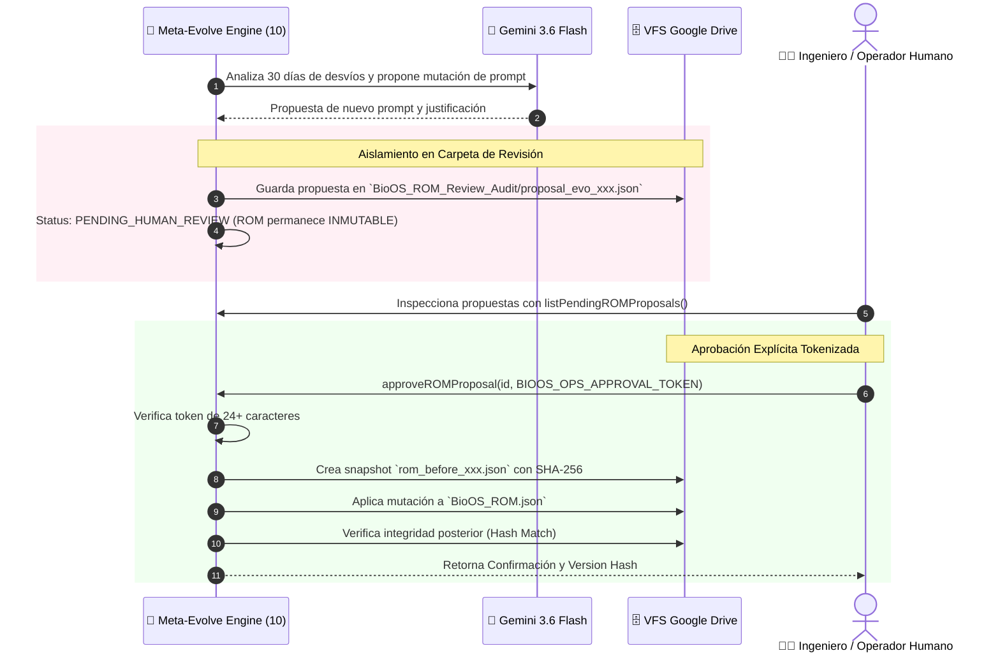

# 📊 FLOW_DIAGRAMS.md — BIOOS CORE DIAGRAMAS DE FLUJO
## Diagramas Arquitectónicos, Flujos de Datos y Ciclos de Vida en Mermaid.js

---

## 1. Ingesta Multimodal & Ciclo Transaccional L0

Muestra cómo las notas de voz, fotos de comida y mensajes de texto son interceptados, autenticados bajo Zero-Trust, desacoplados en la cola durable `Queue_NLP` y procesados de manera asíncrona.

---

## 2. Ciclo de Inferencia Activa y Cooldown Cognitivo L1

Ilustra la toma de decisiones del Orquestador evaluando telemetría de hardware real vs. modelo basal, el anclaje de contexto en L1 (<12h) y la ejecución de la Cadena de Pensamiento Clínica (CoT).

---

## 3. Ciclo de Garbage Collection & Consolidación Jerárquica (L1 $\rightarrow$ L2 $\rightarrow$ L3 $\rightarrow$ L4)

Representa la compresión de contexto por Rate-Distortion y la minería semántica para prevenir la contención de memoria en Google Drive.

---

## 4. Canal de Egress Resiliente & Dead-Letter Protocol

Muestra el pipeline de salida para garantizar que ningún mensaje se descarte en silencio (Zero-Silent-Drop), incluyendo sanitización HTML, balanceo de tags y fallback automático.

---

## 5. Gobernanza de ROM & Meta-Evolución con Doble Verificación

Ilustra la arquitectura de seguridad estricta para la evolución de la memoria de solo lectura (`BioOS_ROM.json`), impidiendo mutaciones arbitrarias en tiempo de ejecución.

