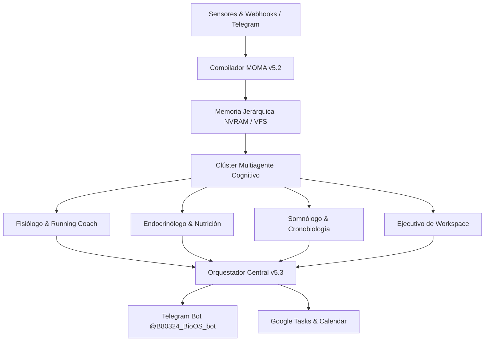
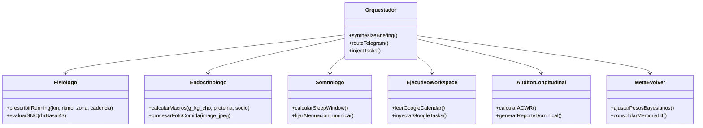

# BioOS Core v8.6.0 (Autonomous Cognitive Kernel)

[](https://github.com/)
[](https://deepmind.google/technologies/gemini/)
[](https://developers.google.com/apps-script)
[](docs/ROADMAP.md)

---

## 1. Manifiesto y Visión del Sistema

**BioOS** es un **Coprocesador Asíncrono de Inferencia Activa** ejecutado de manera desatendida en la nube de Google Apps Script. Su objetivo supremo es absorber la carga administrativa, logística y biológica de su usuario, blindando su ancho de banda cognitivo para mantener un estado sostenido de **Fricción Cero**.

### Perfil Operativo del Usuario
- **Ingeniería & Liderazgo I+D**: Diseño electromecánico, CAD/CAM, robótica cartesiana, instrumentación de bajo nivel y manufactura avanzada.
- **Atleta de Resistencia**: Alto volumen de running de fondo en zonas aeróbicas (Z2/Z4) complementado con fuerza estructural.

### Directiva de Comportamiento y Anti-Degradación
- **Veto de Cortesía Vacía**: Prohibidas frases de relleno ("buenos días", "¿cómo estás?", "¿tienes espacio en tu agenda?").
- **Veto de Generalidades**: Prohibidas sugerencias triviales ("toma luz solar", "camina un poco").
- **Alta Densidad Táctica**: Toda salida del sistema cruza dimensiones biológicas, metabólicas y de agenda entregando prescripciones numéricas procesables.



---

## 2. Arquitectura de Memoria Jerárquica (VFS & NVRAM)

El almacenamiento del sistema se gestiona mediante un **Virtual File System (VFS)** persistido en Google Drive mediante archivos JSON atómicamente versionados:
- **`BioOS_ROM.json`**: Memoria de solo lectura que contiene los invariantes de seguridad inmutables y los system prompts de los agentes.
- **`BioOS_NVRAM.json`**: Memoria no volátil mutable dividida en 5 estratos cognitivos:

| Capa | Nombre Técnico | Propósito y Contenido | Ubicación en Código |
| :--- | :--- | :--- | :--- |
| **L0** | `L0_Ingestion_Cursors` | Cursores temporales y punteros de sincronización de streaming. | [`apps-script/02_Mem_Hierarchical.js:L82`](file:///i:/My%20Drive/BioOS_Core/apps-script/02_Mem_Hierarchical.js#L82) |
| **L1** | `L1_Working` | Memoria de trabajo a corto plazo (`session_events`), flags de sobrecarga. | [`apps-script/02_Mem_Hierarchical.js:L84`](file:///i:/My%20Drive/BioOS_Core/apps-script/02_Mem_Hierarchical.js#L84) |
| **L2** | `L2_Episodic` | Lago de eventos crudos (`raw_data_lake`) y archivos semanales (`weekly_archives`). | [`apps-script/02_Mem_Hierarchical.js:L85`](file:///i:/My%20Drive/BioOS_Core/apps-script/02_Mem_Hierarchical.js#L85) |
| **L3** | `L3_Semantic` | Grafo de conocimiento médico, `evolutionary_weights` y `calibration_deltas`. | [`apps-script/02_Mem_Hierarchical.js:L86-L90`](file:///i:/My%20Drive/BioOS_Core/apps-script/02_Mem_Hierarchical.js#L86-L90) |
| **L4** | `L4_Basal` | Gemelo digital basal (RHR nominal 43 bpm, pasos 8000) y `user_preferences_vector`. | [`apps-script/02_Mem_Hierarchical.js:L91-L97`](file:///i:/My%20Drive/BioOS_Core/apps-script/02_Mem_Hierarchical.js#L91-L97) |

### Poda Adaptativa y Compactación Radical
Para prevenir contención de I/O en Google Drive y mantener la latencia de lectura volátil en `< 2ms`, el motor implementa `_memCompactLakeItem` en [`apps-script/02_Mem_Hierarchical.js:L111`](file:///i:/My%20Drive/BioOS_Core/apps-script/02_Mem_Hierarchical.js#L111), podando arrays densos de sensores deportivos a `< 150 KB` (reducción del 99.75%).

---

## 3. Clúster Multiagente y Motor Cognitivo

El núcleo cognitivo opera como un clúster de agentes especializados antes de sintetizar cualquier directiva táctica:



### Roles y Responsabilidades ([`BioOS_ROM.json`](file:///i:/My%20Drive/BioOS_Core/BioOS_ROM.json))
1. **`[ORQUESTADOR]`**: Coprocesador central de inferencia activa ([`apps-script/06_Agent_Orchestrator.js:L140`](file:///i:/My%20Drive/BioOS_Core/apps-script/06_Agent_Orchestrator.js#L140)).
2. **`[FISIÓLOGO & RUNNING COACH]`**: Modula la carga de running (zonas Z2/Z4, ritmo min/km, cadencia 175-180 ppm, control del SNC).
3. **`[ENDOCRINÓLOGO & NUTRICIÓN]`**: Prescribe gramos de carbohidratos/proteína, hidratación y electrolitos. Procesa fotografías de comida estimando macros.
4. **`[CRONOBIÓLOGO & SOMNÓLOGO]`**: Modela la arquitectura circadiana y calcula la hora exacta de apagado (`sleep_window`).
5. **`[EJECUTIVO DE WORKSPACE]`**: Cruza compromisos en Google Calendar e inyecta tareas directas en Google Tasks vía [`apps-script/12_Workspace_Integration.js:L20`](file:///i:/My%20Drive/BioOS_Core/apps-script/12_Workspace_Integration.js#L20).
6. **`[AUDITOR LONGITUDINAL]`**: Ejecuta la auditoría dominical calculando ACWR y ajuste de microciclos en [`apps-script/10_Meta_Evolve.js:L55`](file:///i:/My%20Drive/BioOS_Core/apps-script/10_Meta_Evolve.js#L55).
7. **`[META_EVOLVER]`**: Calibra pesos evolutivos el día 1 de cada mes en [`apps-script/10_Meta_Evolve.js:L115`](file:///i:/My%20Drive/BioOS_Core/apps-script/10_Meta_Evolve.js#L115).

### Cadena de Modelos Gateway ([`apps-script/01b_LLM_Gateway.js`](file:///i:/My%20Drive/BioOS_Core/apps-script/01b_LLM_Gateway.js))
- **Motor Primario & Multimodal**: `gemini-3.6-flash` (Generación estructurada JSON con `responseSchema`, visión y audio).
- **Fallback de Ultra-Baja Latencia**: `gemini-3.5-flash-lite`.

---

## 4. Cronobiología e Idempotencia de Disparadores

El kernel está sincronizado con la zona horaria `America/Costa_Rica` (UTC-6) mediante 4 disparadores canónicos gestionados en [`apps-script/11_Net_Daemons.js`](file:///i:/My%20Drive/BioOS_Core/apps-script/11_Net_Daemons.js):

| Handler Canónico | Frecuencia / Horario | Propósito Operativo |
| :--- | :--- | :--- |
| **`triggerMorningBriefing`** | **Diario a las 04:00** | Despacho matutino quirúrgico (SNC, running prescrito, macros, agenda Workspace y hora de apagado). |
| **`triggerEveningBriefing`** | **Diario a las 19:00** | Cierre de jornada, protocolo de desconexión del SNC y reconciliación L4 ante ceguera sensorial. |
| **`triggerWeeklyAudit`** | **Domingos a las 18:00** | Reporte táctico dominical, balance ACWR y prescripción de microciclo de carrera. |
| **`triggerMonthlyMetaEvolution`** | **Día 1 a las 02:00** | Auto-tuning mensual de pesos evolutivos bayesianos y consolidación profunda de NVRAM. |

### Garantía de Idempotencia
La función `reconcileCronobiologicalTriggers()` ([`apps-script/11_Net_Daemons.js:L160`](file:///i:/My%20Drive/BioOS_Core/apps-script/11_Net_Daemons.js#L160)) audita la lista de `ScriptApp.getProjectTriggers()`, purga instantáneamente cualquier trigger duplicado o huérfano y mantiene **exactamente 1 instancia activa de cada uno de los 4 handlers**.

---

## 5. Integraciones Externas y Trazabilidad SRE

### A. Telegram Gateway Multimodal
- **Bot**: `@B80324_BioOS_bot` | **Chat ID**: `65004416`
- **Texto**: Respuestas ejecutivas de alta densidad semántica.
- **Audio (`update.message.voice`)**: Descarga unificada de notas de voz en formato `audio/ogg`, transcripción con `gemini-3.6-flash` e inyección de compromisos en Google Tasks.
- **Fotografías (`update.message.photo`)**: Descarga en `image/jpeg`, estimación calórica, desglose de macronutrientes y guardado en la NVRAM metabólica.

### B. Trazabilidad Real vs. Estimada (Anti-Alucinación)
En [`apps-script/06_Agent_Orchestrator.js:L60-L95`](file:///i:/My%20Drive/BioOS_Core/apps-script/06_Agent_Orchestrator.js#L60-L95), el sistema etiqueta explícitamente el origen de los datos:
- **`[HARDWARE_LIVE]`**: Telemetría con menos de 6 horas de antigüedad proveniente de hardware real $\rightarrow$ Inferencia de deltas reales vs basal.
- **`[BASAL_NOMINAL]`**: Ceguera sensorial activa $\rightarrow$ **Veto estricto a inventar datos**. El reporte declara el modelo nominal del Gemelo Digital y emite 1 pregunta quirúrgica de reconciliación cualitativa.

---

## 6. Guía Operativa, Mantenimiento y CLI

### Estructura de Directorios
```text
BioOS_Core/
├── apps-script/              # Código fuente canónico de Google Apps Script
│   ├── 00_Sys_Config.js      # Configuración inmutable y versionado
│   ├── 01_Sys_Telemetry.js   # Telemetría estructurada en Google Sheets
│   ├── 01b_LLM_Gateway.js    # Gateway Gemini con failover resiliente
│   ├── 02_Mem_Hierarchical.js# VFS, NVRAM y poda adaptativa
│   ├── 03b_Net_Webhook.js    # Webhook multimodal y Web App endpoint
│   ├── 05_Bio_Compiler.js    # Compilador MOMA (visión, audio, NLP)
│   ├── 06_Agent_Orchestrator.js # Orquestador y síntesis de despachos
│   ├── 07_Agent_Specialists.js  # Clúster de agentes especialistas
│   ├── 10_Meta_Evolve.js     # Auditoría semanal y meta-evolución
│   ├── 11_Net_Daemons.js     # Triggers cronobiológicos idempotentes
│   ├── 12_Workspace_Integration.js # Google Tasks & Calendar APIs
│   └── appsscript.json       # Manifiesto y scopes de Google Cloud
├── data/backups/             # Copias de seguridad históricas
├── scratch/                  # Scripts de ejecución remota y diagnóstico
├── BioOS_ROM.json            # Invariantes y prompts del clúster
├── CHANGELOG.md              # Registro cronológico de versiones
└── package.json              # Scripts y suite de pruebas
```

### Validación y despliegue
El despliegue de producción se publica con un tag `vX.Y.Z` mediante GitHub Actions, tras configurar `GAS_CLASPRC_JSON`, `BIOOS_GAS_DEPLOYMENT_ID` y el environment `production`. El pipeline actualiza un único deployment estable seleccionado explícitamente. No uses `clasp push --force` para publicar ni los comandos remotos heredados que invocan acciones con efectos secundarios.

Para validar cambios localmente, consulta `docs/OPERATIONS.md`. Un despliegue GAS no instala el puente Android de Health Connect: los datos de Mi Fitness siguen indisponibles hasta implementar, autorizar y conectar ese componente.

---

## 7. Aviso de Responsabilidad y Privacidad

BioOS es un sistema autónomo experimental de apoyo cognitivo y optimización de rendimiento deportivo. No prescribe fármacos ni sustituye el criterio médico clínico. Todos los datos biométricos y de agenda residen exclusivamente dentro de la infraestructura privada de Google Drive y Google Cloud del usuario.

## Second Brain harness

Lee primero [AGENTS.md](AGENTS.md). Para recuperar contexto, crear tickets y comprobar su alcance:

```powershell
npm run harness -- context
npm run ticket -- new BIOOS-YYYYMMDD-01 --title "Meta observable"
npm run ticket -- check BIOOS-YYYYMMDD-01
```

El mapa de memoria, las reglas de evidencia y el ciclo completo están en [docs/agent-harness/README.md](docs/agent-harness/README.md). El harness distingue código local de runtime y bloquea cambios fuera del alcance del ticket.
