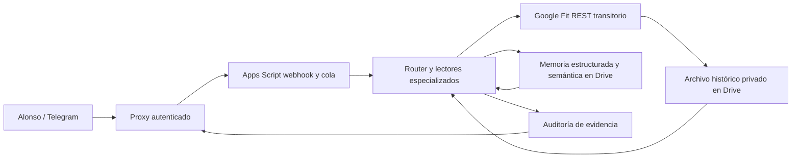

# BioOS Core


**BioOS Core es un orquestador personal de salud y trabajo sobre Google Apps Script.** Recibe mensajes y telemetría autorizada, conserva observaciones con procedencia y responde solo hasta donde llegan los datos disponibles. Es un proyecto privado, experimental y no un dispositivo médico.

> **Estado del código:** `8.15.1` · **rama de trabajo:** `develop` · **runtime:** debe verificarse por separado. Un commit o un PR no publica ni prueba Apps Script.

## Qué hace

- Recibe texto y fotos desde Telegram a través de un proxy autenticado y una cola asíncrona.
- Consulta el proveedor biométrico disponible; actualmente conserva Google Fit REST como ruta existente/transitoria. Un puente Xiaomi/Mi Fitness → Health Connect no forma parte de este repositorio.
- Mantiene memoria estructurada y semántica privada en Drive, separando datos observados, reportados, derivados y desconocidos.
- Puede archivar el histórico Google Fit de solo lectura en shards gzip privados de Drive mediante `/syncfit`, reanudando la lectura por fuente y página.
- Enruta consultas a lectores/especialistas y sintetiza respuestas con evidencia; cuando falta cobertura, debe decir qué falta.

## Vista del sistema



## Primeros pasos

Requiere Node.js 20 o superior. Para instalar dependencias de desarrollo si el proyecto las incorpora, usa `npm install`; este runtime no usa dependencias npm para Apps Script.

```powershell
npm run harness -- context
npm run harness -- policy
npm run check
npm test
```

Los checks locales no leen cuentas personales, no prueban sincronización wearable y no confirman el deployment de Telegram. Revisa [inicio y mapa de documentación](docs/README.md), [arquitectura](docs/ARCHITECTURE.md), [referencia de comandos](docs/TELEGRAM_COMMANDS.md) y [operación/release](docs/OPERATIONS.md).

## Estado real y límites

| Área | Estado del repositorio | Qué evidencia lo confirma |
|---|---|---|
| Aplicación | Apps Script V8, versión fuente 8.15.1 | `package.json`, `apps-script/00_Sys_Config.js` |
| Proveedor | Google Fit REST de compatibilidad; campos sujetos a permisos y sincronización | `/doctor` en el runtime, con fecha, ventana, HTTP y campos |
| Xiaomi Watch 2 / Mi Fitness | No hay bridge Android Health Connect en este repositorio | Código bajo `apps-script/sensors/` y [roadmap](docs/ROADMAP.md) |
| Memoria | L1/L2/L3/L4 con almacenamiento privado; vectores locales de hashing 96D, no embeddings neuronales | [disposición de datos](docs/DATA_LAYOUT.md) |
| Archivo Google Fit | Código reanudable presente; cobertura real depende del `/syncfit status` del propietario | Ticket [BIOOS-20261109-12](docs/tickets/active/BIOOS-20261109-12.md) y estado reportado en [harness](docs/agent-harness/STATE.md) |
| Producción | No inferir desde Git; la última evidencia de runtime debe venir de `/ping`, `/doctor` y despliegues GAS | [operaciones](docs/OPERATIONS.md) |

**Privacidad:** no subir tokens, identificadores privados, imágenes de salud, exportaciones biométricas ni archivos de Drive. Los datos originales de `/syncfit` se mantienen fuera de Git. Consulta [seguridad y configuración](docs/CONFIGURATION.md).

## Contribuir

El repositorio es privado y el flujo sigue tickets acotados, evidencia con procedencia, checks y revisión por PR. Lee [CONTRIBUTING.md](CONTRIBUTING.md) antes de cambiar código, permisos o despliegues. Los cambios de `develop` se proponen a `main` mediante pull request; no se publica producción por hacer merge.

## Licencia y uso

Este repositorio está marcado `private` en `package.json`. No se concede permiso de redistribución o uso clínico por la documentación. Contacta al propietario para cualquier uso fuera del espacio privado.
