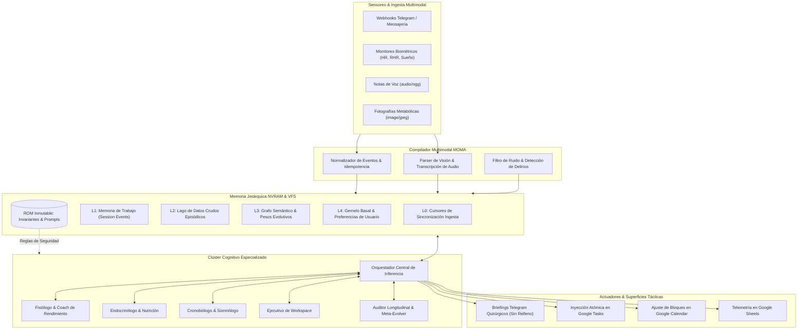

<div align="center">

# BioOS Core

### Autonomous Cognitive Substrate & Active Inference Operating System

[](LICENSE)
[](https://developers.google.com/apps-script)
[](docs/ARCHITECTURE.md)
[](CITATION.cff)
[](LICENSE)

*Un núcleo cognitivo bio-cibernético desatendido que orquesta telemetría fisiológica en tiempo real, inferencia activa basada en minimización de energía libre variacional, y mitigación proactiva de fricción operativa.*

---

</div>

## 1. Elevator Pitch & Tabla de Valor

**BioOS Core** es un coprocesador asíncrono de inferencia activa ejecutado de forma desatendida sobre el runtime serverless de Google Apps Script y validado localmente con Node.js. Diseñado para absorber la sobrecarga administrativa, biometría deportiva y logística ejecutiva de su usuario, el kernel transforma flujos estocásticos de sensores (cardíacos, sueño, nutrición y agenda) en prescripciones operativas deterministas, manteniendo un estado sostenido de **Fricción Cero**.

### ¿Por qué BioOS Core?

| Dimensión | Enfoque Tradicional (Apps & Asistentes) | Paradigma BioOS Core |
| :--- | :--- | :--- |
| **Gobernanza de Datos** | Servidores cerrados de terceros con modelos SaaS opacos. | **Soberanía Absoluta**: Código libre (AGPLv3) persistido en tu propio Google Workspace / Drive VFS. |
| **Cognición y Decisión** | Chatbots reactivos con respuestas genéricas y cortesía vacía. | **Inferencia Activa Multiagente**: Minimización de sorpresa/energía libre con prescripciones numéricas directas. |
| **Memoria y Estado** | Historial de chat efímero o bases vectoriales no contextuales. | **Memoria Jerárquica NVRAM L0–L4**: Estructura estratificada con poda adaptativa y recuperación resiliente. |
| **Trazabilidad Sensorial** | Mezcla de inferencias alucinadas y datos reales sin distinción. | **Contratos SRE Estrictos**: Etiquetado determinista `[HARDWARE_LIVE]` vs `[BASAL_NOMINAL]` (anti-alucinación). |
| **Costo Operativo** | Infraestructura costosa 24/7 (EC2, Kubernetes, DBs). | **Serverless Zero-Cost**: Ejecución por eventos y cronobiología sobre cuotas estándar de Google Cloud / Workspace. |

---

## 2. Arquitectura de Inferencia Activa y Clúster Multiagente

El kernel opera bajo un ciclo cibernético cerrado: los estímulos sensoriales ingresan mediante webhooks autenticados, son normalizados por el compilador multimodal MOMA, actualizan la memoria jerárquica no volátil (NVRAM) y disparan deliberaciones especializadas entre agentes cognitivos antes de emitir directivas tácticas hacia los actuadores.



---

## 3. Memoria Jerárquica (L0–L4)

El almacenamiento cognitivo se estructura en un **Virtual File System (VFS)** persistido atómicamente en Google Drive, separando los invariantes del sistema (`BioOS_ROM.json`) del estado biológico mutable (`BioOS_NVRAM.json`):

| Capa | Nombre Técnico | Propósito y Contenido | Ubicación en Repositorio |
| :--- | :--- | :--- | :--- |
| **L0** | `L0_Ingestion_Cursors` | Punteros de sincronización temporal y cursores de streaming biométrico. | [`apps-script/02_Mem_Hierarchical.js`](apps-script/02_Mem_Hierarchical.js) |
| **L1** | `L1_Working` | Memoria de trabajo volátil (`session_events`), flags de sobrecarga y contención. | [`apps-script/02_Mem_Hierarchical.js`](apps-script/02_Mem_Hierarchical.js) |
| **L2** | `L2_Episodic` | Lago de datos crudos (`raw_data_lake`) y archivos consolidados semanales (`weekly_archives`). | [`apps-script/02_Mem_Hierarchical.js`](apps-script/02_Mem_Hierarchical.js) |
| **L3** | `L3_Semantic` | Grafo de conocimiento médico, pesos bayesianos evolutivos y deltas de calibración. | [`apps-script/02_Mem_Hierarchical.js`](apps-script/02_Mem_Hierarchical.js) |
| **L4** | `L4_Basal` | Gemelo digital basal (RHR nominal, metas de cadencia) y vector de preferencias de usuario. | [`apps-script/02_Mem_Hierarchical.js`](apps-script/02_Mem_Hierarchical.js) |

> [!NOTE]
> Para mantener la latencia de lectura volátil en `< 2ms` y blindar las cuotas de I/O en Drive, el subsistema implementa poda adaptativa (`_memCompactLakeItem`), podando arrays de telemetría deportiva densa a `< 150 KB` (reducción de carga del 99.75%).

---

## 4. Quick Start en 3 Pasos

Despliega tu propia instancia de BioOS Core de forma reproducible:

### Paso 1: Clonar y configurar variables de entorno
```bash
git clone https://github.com/alonsoalvaradohr/BioOS_Core.git
cd BioOS_Core
cp .env.example .env
```
Edita `.env` con tus tokens de Telegram y clave de Gemini AI (consulta [.env.example](.env.example) para ver la plantilla de configuración completa).

### Paso 2: Instalar dependencias y verificar contratos
```bash
npm install
npm run verify
```
El comando `npm run verify` ejecuta la validación estática de contratos (`scripts/validate.mjs`) y la suite completa de pruebas unitarias (`apps-script/qa/*.node.test.js`).

### Paso 3: Desplegar hacia Google Apps Script con Clasp
Configura el identificador de tu script en `.clasp.json` y despliega:
```bash
npx @google/clasp login
npx @google/clasp push --force
npx @google/clasp deploy --description "BioOS Core - Production Deploy"
```

---

## 5. Roadmap & Help Wanted

BioOS Core es un proyecto de código abierto en evolución activa. Buscamos colaboradores de la comunidad en las siguientes áreas de impacto:

- [ ] **Conectores Locales LLM / Inferencia Offline**: Adaptador para modelos locales vía [Ollama](https://github.com/ollama/ollama) o [vLLM](https://github.com/vllm-project/vllm) como fallback soberano ante desconexión de red.
- [ ] **Integraciones Biométricas Wearables**: Drivers de sincronización con Garmin Health API, Apple HealthKit (vía exportador seguro) y anillos Oura.
- [ ] **Pruebas Unitarias y Cobertura QA**: Expansión de la suite en `apps-script/qa/` para simulación estocástica de estados fisiológicos extremos.
- [ ] **Visualizador Web Local**: Dashboard estático ligero (HTML5 Canvas / WebAssembly) para inspeccionar la topología de la NVRAM sin consultar directamente Drive.

¿Quieres contribuir? Revisa nuestra [Guía de Contribución](CONTRIBUTING.md) y nuestro [Código de Conducta](CODE_OF_CONDUCT.md) antes de enviar un Pull Request.

---

## 6. Citación, Autoría y Licencia

Este proyecto ha sido desarrollado bajo principios de rigor biomecánico, soberanía de datos y ciberdeliberación autónoma.

### Citación Académica y Técnica
Si utilizas BioOS Core en tus investigaciones, modelos de inferencia activa o desarrollos clínicos/cognitivos, por favor cita el proyecto utilizando el archivo [CITATION.cff](CITATION.cff):

```bibtex
@software{Alvarado_Hernandez_BioOS_Core_2026,
  author = {Alvarado Hernández, Alonso},
  title = {{BioOS Core: Autonomous Cognitive Active Inference Kernel}},
  year = {2026},
  version = {8.5.0},
  license = {AGPL-3.0-or-later},
  url = {https://github.com/alonsoalvaradohr/BioOS_Core}
}
```

### Licencia
BioOS Core se distribuye bajo los términos de la licencia **GNU Affero General Public License v3.0 or later** ([AGPL-3.0-or-later](LICENSE)). Toda mejora o servicio de red derivado debe preservar el código abierto para la comunidad.
