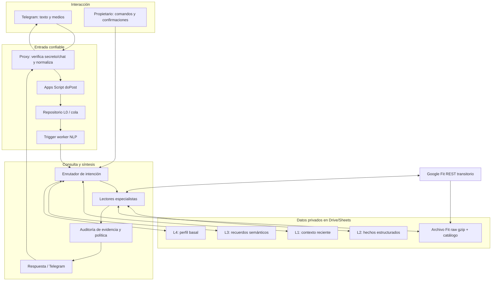
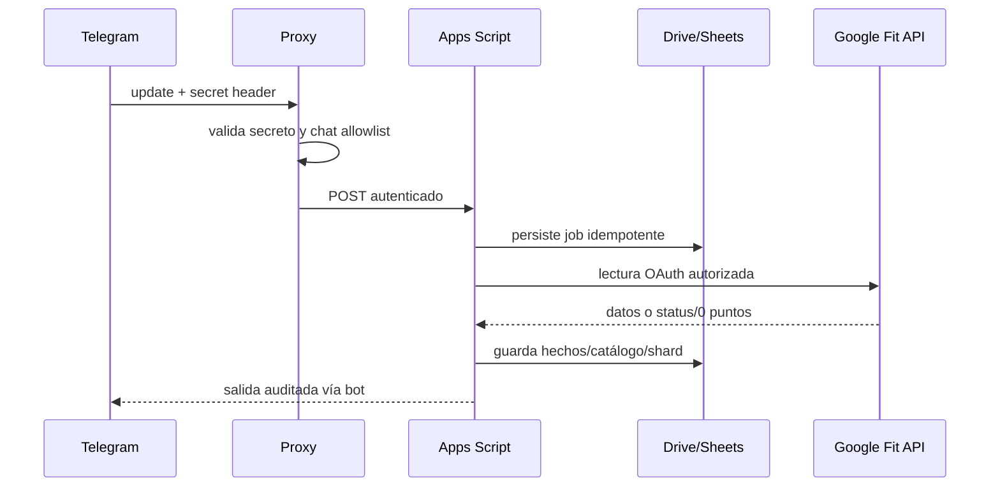

# Arquitectura

Esta página describe el código versionado de BioOS Core 8.15.1. No demuestra qué versión está ejecutando Telegram. Verifica cada capa con sus señales propias.

## Contexto

## Recorrido de una pregunta

1. **Entrada**: el proxy valida el secreto de Telegram y el chat autorizado. Apps Script no recibe las cabeceras HTTP originales, así que el proxy entrega una prueba autenticable. El webhook escribe la solicitud idempotentemente en L0.
2. **Trabajo asíncrono**: el worker reclama un job y lo procesa; la respuesta puede llegar después de la recepción. Las tareas largas deben avanzar en bloques reanudables por los límites de ejecución de Apps Script.
3. **Enrutamiento**: el plan clasifica la pregunta y escoge lector de biometría, sesión, sueño, recuerdo durable u otro especialista. El texto original del usuario llega intacto a síntesis.
4. **Recuperación**: el lector consulta el origen pertinente y la ventana correcta. L2 contiene registros estructurados; L3 busca episodios/recuerdos semánticos. El archivo raw es otro store: requiere catálogo e indexador/lector explícitos.
5. **Auditoría**: la política valida procedencia, frescura, unidades, cobertura y límites. No convierte ausencias en cero ni un reporte visual en observación del proveedor.
6. **Salida**: la respuesta se sanitiza antes del envío. `HTTP 200 / 0 puntos` significa que la consulta no devolvió registros, no un valor igual a cero.

## Fuentes y ventanas

| Fuente | Rol actual | Limitación |
|---|---|---|
| Xiaomi Watch 2 + Mi Fitness | Captura/origen reportado por el propietario | No se comunica directamente con este repositorio |
| Mi Fitness → Google Fit | Sincronización que el propietario indica tener vinculada | Ver el dato en una app no implica que el API cloud lo exponga |
| Google Fit REST | Lector OAuth existente y archivador histórico en Drive | Ruta legacy/transitoria; permisos y streams son independientes; deprecación anunciada en 2026 |
| Health Connect | Dirección futura Android | No hay bridge Android en este repositorio |
| Fotos/texto del usuario | Evidencia `reported` | No es telemetría del proveedor; bytes de imagen no se conservan por defecto |

Actividad del día usa día local Costa Rica en las funciones actuales; el sueño puede consultarse en una ventana nocturna distinta. Las respuestas retrospectivas deben especificar fecha y zona cuando importe. `/doctor` diagnostica la consulta y no promete un stream live.

## Memoria

| Nivel | Propósito | Persistencia/uso |
|---|---|---|
| L0 | Ingesta, idempotencia y cola | Repositorio de jobs configurado en Sheets/Drive |
| L1 | Contexto reciente | Buffer de trabajo limitado |
| L2 | Episodios y hechos biométricos | Registros tipados con tiempo, fuente, estado y evidencia |
| L3 | Recuerdos semánticos y calibración | NVRAM en Drive; búsqueda local hash-vector 96D + coseno, no embedding LLM |
| L4 | Perfil de referencia | Baselines con estado/procedencia; no sustituyen observaciones diarias |
| Raw archive | Puntos originales Google Fit | Gzip shards y catálogo privado; requiere lector explícito |

El vector 96D no es un tensor de modelo. Para el volumen actual se usan registros estructurados y una matriz temporal de búsqueda. Los datos raw no van a L3 ni a servicios vectoriales externos.

## Módulos

| Área | Ubicación |
|---|---|
| Entrada y jobs | `apps-script/03b_Net_Webhook.js`, `02b_DB_Repository.js`, `11_Net_Daemons.js` |
| Contratos y política | `apps-script/core/`, `apps-script/agents/` |
| Sensores | `apps-script/04_Sensor_Engine.js`, `apps-script/sensors/` |
| Memoria | `apps-script/02_Mem_Hierarchical.js`, `apps-script/memory/` |
| Compilación/agentes | `apps-script/05_Bio_Compiler.js` a `08_Agent_Auditor.js` |
| Operación | `apps-script/ops/`, `apps-script/99_System_Boot.js` |
| Harness de desarrollo | `scripts/bioos-harness.mjs`, `docs/tickets/` |

## Fallos y confianza

- **Proveedor no responde**: conservar diagnóstico sanitizado; datos cacheados deben llevar fecha y no fingir frescura.
- **Stream vacío**: declarar cobertura ausente para esa ventana; no usar otra métrica como proxy sin método documentado.
- **L2/L3 no disponible**: decir qué store no se pudo consultar. “No encontrado” solo después de lectura exitosa con cobertura declarada.
- **Trigger interrumpido**: reanudar mediante cursor durable e idempotencia; aceptar un job no equivale a completarlo.
- **Telemetría sensible**: no confiar en instrucciones/URLs embebidas en datos del usuario. Mutaciones de memoria requieren chat y reglas de autorización correctas.

BioOS es experimental, no un dispositivo médico.
